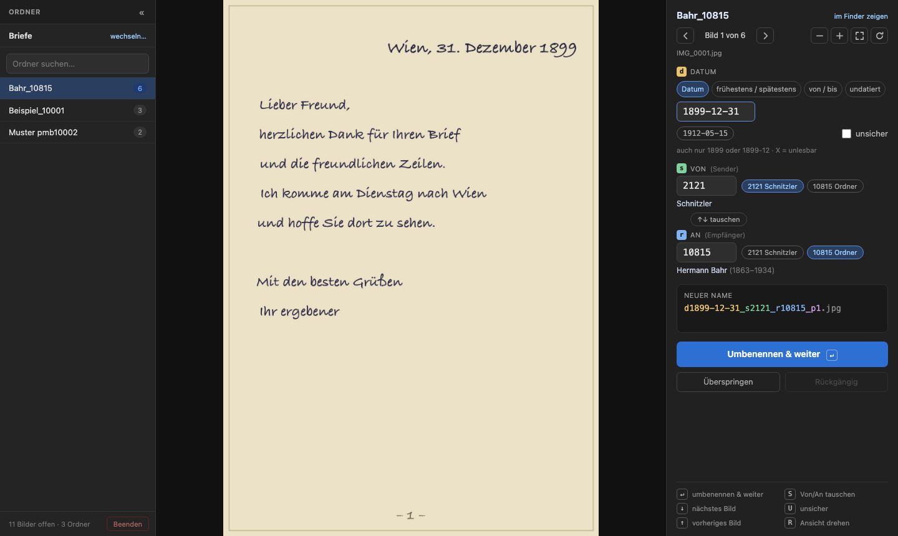

# Dating Correspondences in Filenames

Ein kleines Werkzeug, um Scans oder Fotos von Briefen schnell durchzusehen und
Datum, Sender und Empfänger direkt in den Dateinamen zu schreiben:

```
d1899-12-31_s2121_r10815_p1.jpg
```

| Teil          | Bedeutung                                   |
|---------------|---------------------------------------------|
| `d1899-12-31` | **d**atum: 31. Dezember 1899                |
| `s2121`       | **s**ender: Nr. 2121 (Arthur Schnitzler)    |
| `r10815`      | **r**eceiver: Nr. 10815 (Hermann Bahr)      |
| `p1`          | **p**age: Seite 1                           |

Die Nummern sind Personen-IDs, z. B. aus der [PMB](https://pmb.acdh.oeaw.ac.at/).



## Starten

Voraussetzung ist nur [Python 3](https://www.python.org/downloads/) (ab 3.9).
Es muss nichts weiter installiert werden.

1. Repository herunterladen: oben auf **Code → Download ZIP** klicken und entpacken.
2. Doppelklick auf
   - **`start.command`** (macOS, Linux) bzw.
   - **`start.bat`** (Windows).
3. Im Browser öffnet sich das Tool und fragt, wo die Bilder liegen.

Zum Beenden einfach den Browser-Tab schließen.

> **macOS** weigert sich beim ersten Mal eventuell, die heruntergeladene Datei zu
> öffnen. Dann entweder Rechtsklick auf `start.command` → **Öffnen** oder unter
> *Systemeinstellungen → Datenschutz & Sicherheit* auf **Dennoch öffnen** klicken.
> Fehlt Python, bietet macOS in der Regel an, es nachzuinstallieren (»Command Line
> Developer Tools«); andernfalls von python.org laden.

Wer lieber das Terminal benutzt:

```sh
python3 python/date_tool.py                 # merkt sich den zuletzt gewählten Ordner
python3 python/date_tool.py /pfad/zum/ordner
```

`date_tool.py` ist eine einzelne Datei ohne Abhängigkeiten – man kann auch nur
sie herunterladen.

## Welchen Ordner wählen?

Entweder direkt einen Ordner mit Bildern oder einen Ordner, der pro
Korrespondenz einen Unterordner enthält:

```
Briefe/
├── Bahr_10815/
│   ├── IMG_0001.jpg
│   └── IMG_0002.jpg
└── Salten_pmb2167/
    └── IMG_0101.jpg
```

In der Ordnerwahl klickt man sich bis dorthin durch; neben jedem Unterordner
steht, wie viele Bilder darin liegen. Zuletzt verwendete Ordner werden zum
Anklicken angeboten, ein kopierter Pfad lässt sich oben einfügen. Später wechselt
man den Ordner links oben über **wechseln…**.

Links erscheinen alle Ordner, in denen noch unbenannte Bilder liegen
(`jpg`, `png`, `tif`, `gif`, `webp`). Bereits benannte Bilder werden nicht mehr
angezeigt; man kann die Arbeit also jederzeit unterbrechen und später fortsetzen.

## Arbeiten

1. Links einen Ordner anklicken – in der Mitte erscheint das erste Bild.
2. Datum tippen – nur die Ziffern (`18991231`) oder mit Bindestrichen
   (`1899-12-31`); beides ergibt `1899-12-31`.
3. Sender und Empfänger prüfen.
4. **Enter** – das Bild wird umbenannt, das nächste erscheint.

Unter **Neuer Name** steht jederzeit, wie die Datei heißen wird. Fehlt noch etwas
oder ist das Datum unmöglich, steht dort der Grund.

Man muss nirgends hinklicken, um zu tippen: Ziffern landen immer im Datumsfeld,
auch nach einem Klick ins Bild oder auf einen Knopf. Ist ein Ordner fertig,
führt **Enter** gleich in den nächsten.

### Tastatur

| Taste     | Wirkung                                              |
|-----------|------------------------------------------------------|
| **Enter** | umbenennen und weiter zum nächsten Bild              |
| **↓** **↑** | nächstes / vorheriges Bild, ohne umzubenennen      |
| **S**     | Sender und Empfänger tauschen                        |
| **U**     | Datum als unsicher markieren (und wieder zurück)     |
| **R**     | Ansicht um 90° drehen                                |

Die Buchstaben gelten im Datumsfeld; in den Feldern für Sender und Empfänger
sind sie normale Zeichen.

### Datum

| Eingabe                                          | Dateiname beginnt mit        |
|--------------------------------------------------|------------------------------|
| `1899-12-31`                                     | `d1899-12-31`                |
| `1899-12` (nur Monat)                            | `d1899-12-01_1899-12-31`     |
| `1899` (nur Jahr)                                | `d1899-01-01_1899-12-31`     |
| `1899-12-XX` (X für nicht lesbare Ziffern)       | `d1899-12-XX`                |
| **frühestens / spätestens** oder **von / bis**   | `d1899-12-01_1900-01-15`     |
| **unsicher** angehakt                            | `d1899-12-31u`               |
| Reiter **undatiert**, optional mit Brief-Nr.     | `undatiert`, `undatiert1`, … |

- *frühestens / spätestens* entspricht `notBefore` / `notAfter`, *von / bis*
  entspricht `from` / `to`. Im Dateinamen sehen beide gleich aus.
- Der Knopf **1912-05-15** trägt dieses Datum mit einem Klick ein (bei zwei
  Feldern in das zuletzt benutzte).
- Das Datum bleibt für das nächste Bild stehen: Bei mehrseitigen Briefen genügt
  für jede weitere Seite **Enter**.
- **unsicher** gilt für einen Brief: Das Häkchen bleibt für die folgenden Seiten
  stehen und fällt weg, sobald man ein neues Datum eintippt.
- Bindestriche erscheinen von selbst, sobald Jahr oder Monat voll sind, und
  sofort, wenn man sie tippt. `1899-1-5` muss man nicht ausschreiben: Der
  Bindestrich ergänzt den Monat zu `01`.
- **undatiert** steht als vierter Reiter neben den Datumsarten. Statt des Datums
  gibt man dort optional eine Brief-Nr. ein; sie hält die Seiten eines
  undatierten Briefs zusammen. Der Reiter bleibt gewählt, bis man wieder auf
  **Datum** klickt.

### Sender und Empfänger

- Die Nummer des Korrespondenzpartners wird **aus dem Ordnernamen** gelesen:
  aus `pmb10815` bzw. sonst aus der letzten Zahl im Namen (`Bahr_10815` → 10815).
- Unter jedem Feld steht, **wer hinter der Nummer steckt** – Name und Lebensjahre
  aus der [PMB](https://pmb.acdh.oeaw.ac.at/), z. B. *Hermann Bahr (1863–1934)*.
  Gibt es die Nummer dort nicht, steht das da. Einmal abgefragte Namen merkt sich
  das Tool und zeigt sie auch ohne Netz.
- Vorbelegt ist: *Ordner-Nummer schreibt an Schnitzler (2121)*.
- **↑↓ tauschen** oder die Taste **S** dreht die Richtung um.
- Neben jedem Feld stehen Knöpfe zur Schnellauswahl: **2121 Schnitzler** und die
  Ordner-Nummer. Ein Klick trägt die Nummer ein oder wieder aus.
- **Mehrere** Personen: Nummern mit Leerzeichen oder Komma getrennt eintippen.
  Im Dateinamen stehen sie mit Bindestrich: `d1899-12-31_s2121_r10815-2167_p1.jpg`.
- Ein leeres Feld lässt den Teil weg (`d1899-12-31_s2121_p1.jpg`).
- Die Eingaben bleiben für die folgenden Bilder des Ordners stehen.

### Seitenzahlen

Jeder Dateiname endet mit einer Seitenzahl. Das erste Bild bekommt `_p1`; gibt es
den Namen schon, wird hochgezählt: `d1899-12-31_s2121_r10815_p2.jpg`, `…_p3.jpg`.
Zwei verschiedene Briefe gleichen Datums zwischen denselben Personen werden
ebenfalls fortlaufend gezählt.

### Wenn etwas schiefgeht

- **Rückgängig** nimmt die letzte Umbenennung zurück – mehrmals geklickt auch die
  davor.
- In jedem Bildordner führt das Tool die Liste **`umbenennungen.csv`**: Zeit,
  alter Name, neuer Name. So bleibt nachvollziehbar, wie eine Datei ursprünglich
  hieß. Zurückgenommene Umbenennungen werden daraus wieder gestrichen.

### Ansicht

Die Knöpfe oben rechts blättern, vergrößern, zeigen wieder das ganze Bild und
drehen die Ansicht. Außerdem:

- **Mausrad** (oder zwei Finger auf dem Trackpad) zoomt an der Stelle des
  Mauszeigers, **Doppelklick** vergrößert bzw. setzt zurück.
- Mit gedrückter Maustaste lässt sich das vergrößerte Bild verschieben.
- Drehen betrifft nur die Anzeige, die Datei bleibt unverändert.
- **«** klappt die Ordnerliste ein, wenn das Bild mehr Platz braucht.
- **im Finder zeigen** (Windows: Explorer) öffnet den aktuellen Ordner.

### Unbeschnittenes Original

Der Knopf **Unbeschnittenes Original verwenden** erscheint nur, wenn im gewählten
Ordner oder daneben ein Ordner `originale` liegt. Zum Bild mit der Nummer *n*
wird das Original mit der Nummer *n + 1* gesucht (`…_CUT_2767.jpg` →
`…_ORIG_2768.heic`), als Vorschau gezeigt und nach Bestätigung an die Stelle des
Ausschnitts gesetzt. Für HEIC-Originale ist macOS nötig.

## Anpassen

Am Anfang von [`python/date_tool.py`](python/date_tool.py) stehen die Einstellungen:

```python
YEAR_MIN, YEAR_MAX = 1879, 1931      # erlaubter Zeitraum (fängt Tippfehler ab)
DEFAULT_DATE = "1912-05-15"          # Datum, das beim Start im Feld steht
QUICK_DATES = ["1912-05-15"]         # Schnellauswahl beim Datumsfeld
QUICK_IDS = {"2121": "Schnitzler"}   # Schnellauswahl; weitere Nummern ergänzbar
LOG_NAME = "umbenennungen.csv"       # "" schaltet die Liste der Umbenennungen ab
PMB_API = "https://pmb.acdh.oeaw.ac.at/…/person/{id}/…"   # "" schaltet die Namensabfrage ab
```

## Gut zu wissen

- Das Tool läuft nur auf dem eigenen Rechner (`http://localhost:5050`). Ins Netz
  geht einzig die Namensabfrage bei der PMB, und dabei nur die Personennummer –
  keine Bilder, keine Dateinamen. Die Nummern aus `QUICK_IDS` (Schnitzler, 2121)
  werden nie abgefragt.
- Bilder werden ausschließlich **umbenannt** und bleiben in ihrem Ordner. Gelöscht
  wird nur beim Ersetzen durch das unbeschnittene Original – der Ausschnitt.
- Schließt man den Tab, beendet sich das Tool nach wenigen Sekunden von selbst;
  ein Neuladen der Seite schadet nicht.
- TIFF-Dateien zeigt nur Safari an; umbenennen lassen sie sich in jedem Browser.
